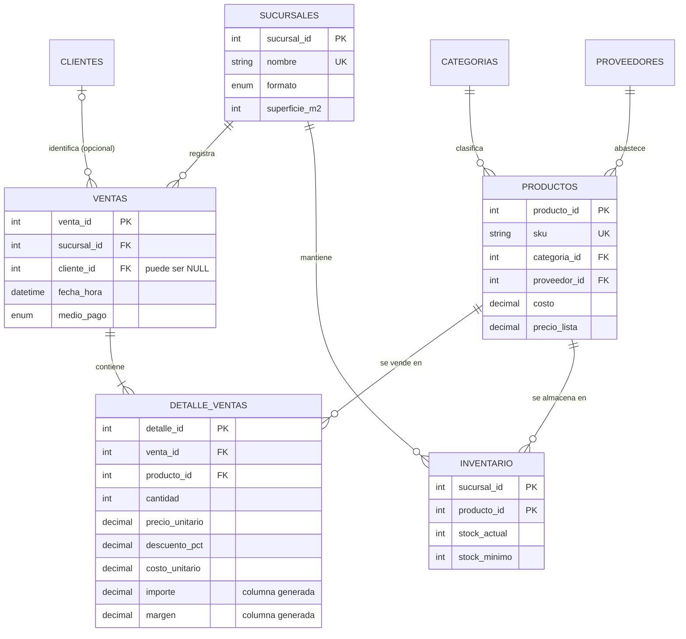
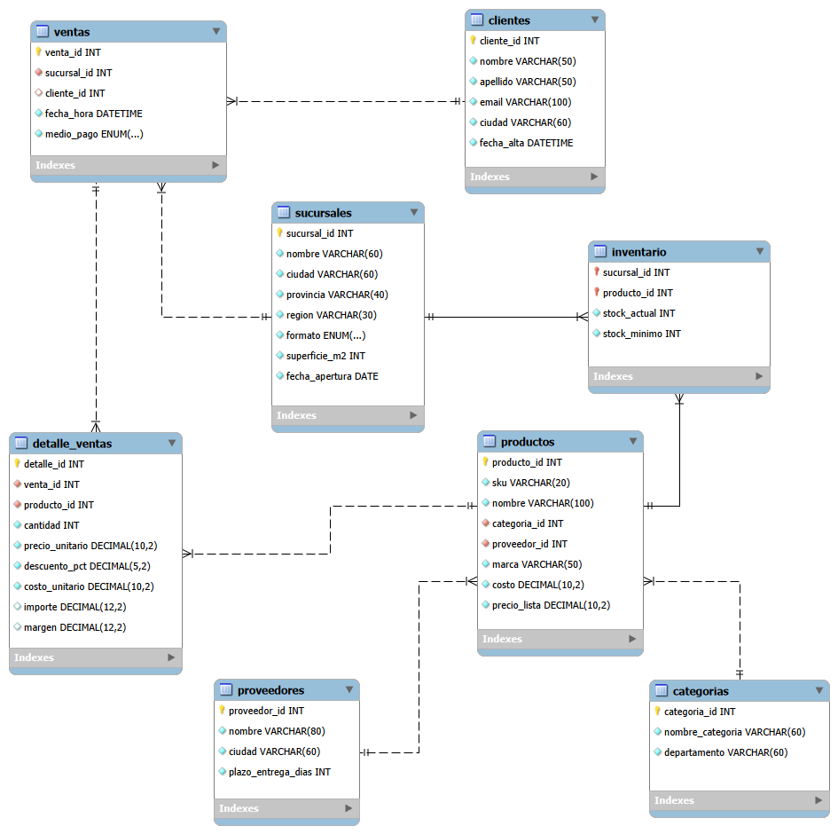
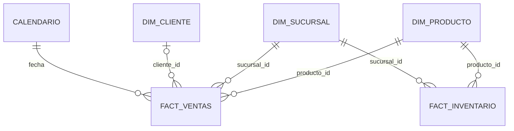
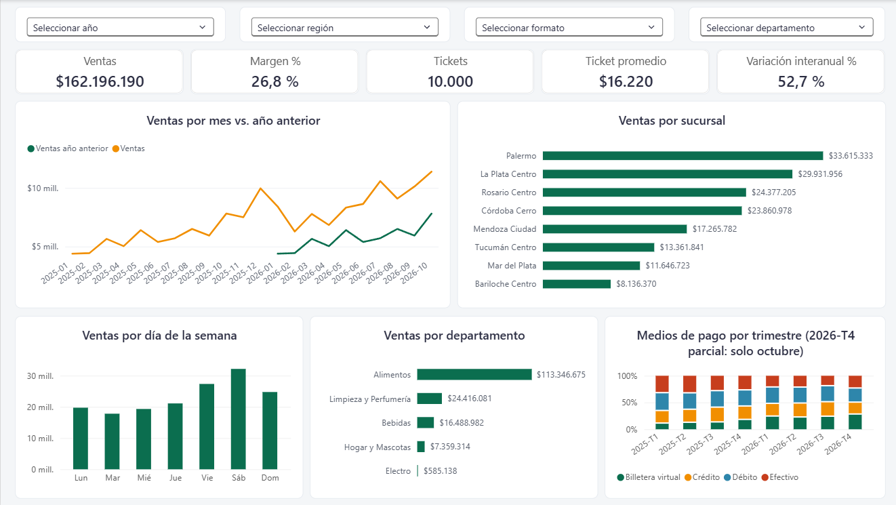
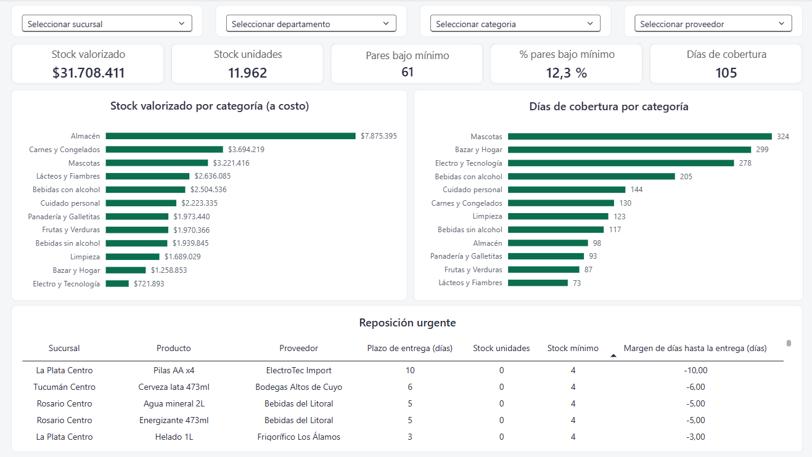

# 🏬 Proyecto SQL: Análisis de una cadena de supermercados

Base de datos relacional para una cadena de supermercados ficticia (8 sucursales, 10.000 tickets en 22 meses), desarrollada en **MySQL 8**. Incluye datos sintéticos reproducibles, 12 consultas analíticas (CTEs, funciones de ventana, ABC, segmentación de clientes, control de stock) y un modelo en **esquema en estrella** para Power BI con dos tablas de hechos: ventas e inventario.

**Qué demuestra este proyecto:** diseño de una base normalizada con integridad de datos, SQL analítico de nivel intermedio-avanzado, modelado dimensional y su conexión con una herramienta de BI.

## 📑 Contenido

- [Modelo de datos](#-modelo-de-datos-base-transaccional)
- [Decisiones de diseño](#-decisiones-de-diseño)
- [Modelo en Power BI](#-modelo-en-power-bi-esquema-en-estrella)
- [Estructura del repositorio](#-estructura-del-repositorio)
- [Cómo ejecutarlo](#️-cómo-ejecutarlo)
- [Consultas incluidas](#-consultas-incluidas)
- [Hallazgos de ejemplo](#-hallazgos-de-ejemplo)
- [Dashboard en Power BI](#-dashboard-en-power-bi)
- [Limitaciones conocidas](#-limitaciones-conocidas)

## 🧩 Modelo de datos (base transaccional)


Diagrama completo exportado desde MySQL Workbench, con todas las columnas y tipos de datos:



## 🧠 Decisiones de diseño

Cada decisión se explica con el mismo esquema: **qué se hizo**, **por qué** y **qué se cedió a cambio**.

### 1. Los importes tienen una única fuente de verdad

- **Qué:** la tabla `ventas` (el ticket) no guarda ningún total. En `detalle_ventas`, `importe` (venta neta de descuento) y `margen` son **columnas generadas** (`GENERATED ALWAYS … STORED`). Cualquier total se obtiene sumando esas columnas.
- **Por qué:** si el total del ticket se guardara aparte, podría quedar distinto de la suma de sus líneas (por ejemplo, si se corrige una línea y nadie actualiza el total). Al calcularlo siempre desde el detalle, esa inconsistencia no puede existir. Las columnas generadas, además, garantizan que `importe` y `margen` se calculen igual en todos los registros.
- **Costo:** sumar el detalle en cada consulta es algo más lento que leer un total ya guardado. Con este volumen no se nota, y con más datos se resuelve con una tabla resumen.

### 2. Precio y costo históricos en cada línea

- **Qué:** cada fila de `detalle_ventas` guarda el `precio_unitario` y el `costo_unitario` vigentes al momento de la venta. Los campos `costo` y `precio_lista` de `productos` son los valores **actuales** del catálogo.
- **Por qué:** los precios y costos cambian (en el modelo, con inflación mensual). Si el margen se calculara contra el costo actual, el margen de ventas pasadas cambiaría cada vez que se actualiza el catálogo. Guardar el valor del momento hace que el margen histórico sea siempre correcto.
- **Costo:** se repite información (el precio aparece en el catálogo y en cada línea). Es una duplicación intencional: son dos datos distintos, el precio de hoy y el precio de esa venta.

### 3. El cliente es opcional

- **Qué:** `ventas.cliente_id` admite `NULL`. Un `NULL` representa una venta a un cliente no identificado (no socio).
- **Por qué:** en retail la mayoría de las ventas pueden no estar asociadas a un socio. Obligar a tener un cliente en cada ticket obligaría a inventar un cliente genérico, que distorsionaría los análisis de clientes. Con `NULL`, comparar socios contra no identificados es un simple `IS NULL` (consulta 9).
- **Costo:** hay que recordar que `NULL` no se compara con `=` y que un `JOIN` común descarta esas ventas. Las consultas usan `LEFT JOIN` donde corresponde, y la regla `ON DELETE SET NULL` hace que borrar un cliente no borre su historial de compras.

### 4. Surtido por formato

- **Qué:** `inventario` contiene solo los pares sucursal-producto que existen, con clave primaria compuesta `(sucursal_id, producto_id)`. El Express no vende electro, mascotas ni bazar, y el supermercado no vende electro.
- **Por qué:** una fila con stock cero significa "se vende, pero se agotó". La ausencia de fila significa "esta sucursal no maneja ese producto". Son situaciones distintas, y llenar la tabla con ceros las confundiría y falsearía las métricas de stock.
- **Costo:** para saber qué productos no vende una sucursal hay que cruzar contra el catálogo.

### 5. Integridad garantizada por la base, no por la aplicación

- **Qué:**
  - Claves foráneas con regla de borrado explícita: `RESTRICT` en catálogos (no se puede borrar una categoría, proveedor o producto en uso), `CASCADE` en detalle e inventario (si se borra un ticket o una sucursal, se borran sus filas dependientes) y `SET NULL` en el cliente de una venta.
  - Restricciones `CHECK`: precios y costos mayores a cero, cantidades positivas, descuento entre 0 y 100, stock no negativo.
  - Índices sobre `fecha_hora` y `medio_pago`, que son los filtros más usados en las consultas. Las claves foráneas ya generan sus propios índices en InnoDB.
- **Por qué:** una regla definida en la base se cumple sin importar quién cargue los datos. Las reglas de borrado impiden dejar registros huérfanos.
- **Costo:** las restricciones agregan una pequeña verificación en cada escritura, irrelevante para un uso analítico.

### 6. Tipos de datos

- **Qué:** los importes usan `DECIMAL`, nunca `FLOAT`. Las listas cerradas (`formato`, `medio_pago`) usan `ENUM`. Todo el esquema usa `utf8mb4` e InnoDB.
- **Por qué:** `DECIMAL` evita los errores de redondeo de los decimales binarios, inaceptables para dinero. `ENUM` limita los valores posibles y ocupa poco. `utf8mb4` permite tildes, eñes y cualquier carácter sin problemas.
- **Costo:** agregar un valor nuevo a un `ENUM` (por ejemplo, un medio de pago) requiere modificar la tabla. Para listas que cambian seguido convendría una tabla aparte.

### 7. Las vistas separan el modelo analítico del transaccional

- **Qué:** la base transaccional está normalizada (sin repetir datos). Para el análisis, cinco vistas (`vw_fact_*` y `vw_dim_*`) la presentan como **esquema en estrella**. Por ejemplo, `vw_dim_producto` junta producto, categoría, departamento y proveedor en una sola tabla.
- **Por qué:** la normalización es buena para cargar datos sin inconsistencias, pero para analizar conviene tener pocas tablas anchas, que son más simples de entender y más rápidas en Power BI. Las vistas dan ambos modelos sobre los mismos datos, sin duplicarlos ni mantener dos cargas.
- **Costo:** las vistas se calculan en cada lectura. Para volúmenes grandes habría que materializarlas en tablas.

### 8. Inventario como "foto" y dos tablas de hechos

- **Qué:** `inventario` guarda el stock **actual**, no su historia. En Power BI hay dos tablas de hechos (ventas e inventario) que comparten las dimensiones de producto y sucursal.
- **Por qué:** compartir dimensiones permite cruzar ambas tablas, por ejemplo para calcular **días de cobertura de stock** (stock actual dividido por la venta diaria promedio). Una única tabla plana no permitiría ese cruce.
- **Costo:** al no tener historia, no se puede analizar cómo evolucionó el stock en el tiempo (ver [Limitaciones](#-limitaciones-conocidas)).

## ⭐ Modelo en Power BI (esquema en estrella)

En lugar de una única tabla plana, Power BI se conecta a **cinco vistas** que separan los hechos (lo que se mide) de las dimensiones (los ejes de análisis), más una tabla `Calendario` creada con DAX:



| Vista | Rol | Contenido |
|---|---|---|
| `vw_fact_ventas` | Hechos | Una fila por línea de ticket: cantidad, importe, costo, margen, descuento |
| `vw_fact_inventario` | Hechos | Foto de stock por sucursal y producto, con valorización y marca de stock bajo |
| `vw_dim_producto` | Dimensión | Producto, marca, categoría, departamento y proveedor ya unidos |
| `vw_dim_sucursal` | Dimensión | Ciudad, provincia, región, formato y superficie |
| `vw_dim_cliente` | Dimensión | Socios del programa de beneficios |

Con las dos tablas de hechos compartiendo dimensiones se puede cruzar ventas e inventario (por ejemplo, días de cobertura de stock) y analizar a los clientes sin identificar y a los productos sin ventas, algo que una vista plana no permite.

## 📁 Estructura del repositorio

| Archivo | Contenido |
|---|---|
| `01_schema.sql` | Base, tablas, restricciones, índices y las cinco vistas del modelo en estrella |
| `02_seed_data.sql` | Datos ficticios: 8 sucursales, 69 productos, 2.500 clientes, 10.000 tickets (ene 2025 – oct 2026) |
| `03_queries.sql` | 12 consultas analíticas |
| `generate_seed.py` | Generador del seed (Python, solo librería estándar) |
| `powerbi/` | Dashboard (`.pbix`), medidas DAX, tema de formato y guía de armado |
| `docs/` | Diagrama ER exportado de MySQL Workbench |

## ▶️ Cómo ejecutarlo

Requisitos: **MySQL 8.0.16 o superior** (los `CHECK` se ignoran en silencio en versiones anteriores y las funciones de ventana requieren MySQL 8).

> ⚠️ `01_schema.sql` ejecuta `DROP DATABASE IF EXISTS retail_db`: borra la base si ya existe.

```bash
mysql --default-character-set=utf8mb4 -u root -p < 01_schema.sql
mysql --default-character-set=utf8mb4 -u root -p < 02_seed_data.sql
mysql --default-character-set=utf8mb4 -u root -p < 03_queries.sql
```

El seed pesa unos 2,5 MB. Desde MySQL Workbench puede tardar un momento en abrirse y ejecutarse; por terminal es más rápido.

### Regenerar o escalar los datos
```bash
python generate_seed.py                                    # valores por defecto
python generate_seed.py --tickets 50000 --clientes 8000 --seed 7
```
El generador es reproducible (misma semilla, mismo archivo) y verifica la coherencia de los datos: el stock nunca es negativo, ningún cliente se da de alta después de su primera compra, no hay productos repetidos dentro de un ticket y cada sucursal vende solo su surtido.

Los datos simulan estacionalidad (pico de diciembre, más ventas de viernes a domingo y productos de verano como el protector solar, el helado y el ventilador), una canasta básica que se compra más seguido, socios con tickets más grandes, franjas horarias con picos a media mañana y a la tarde-noche, clientes socios con sucursal habitual, precios con inflación mensual, descuentos y una migración gradual hacia pagos con billetera virtual.

## 📊 Consultas incluidas

| # | Consulta | Técnicas |
|---|---|---|
| 1 | Desempeño por sucursal: ventas, margen y ventas por m² | `JOIN`, agregación, `RANK()` |
| 2 | Ventas mensuales, variación mensual e interanual | CTE, `LAG()` y `LAG(…, 12)` |
| 3 | Top 10 productos por margen | `JOIN`, agregación |
| 4 | Análisis ABC (Pareto) de productos | CTE, `SUM() OVER`, `CASE` |
| 5 | Ventas por día de la semana | CTE, `DAYOFWEEK`, `SUM() OVER ()` |
| 6 | Ticket promedio por franja horaria | CTE, `HOUR`, `AVG` |
| 7 | Mix de medios de pago por trimestre | `PARTITION BY`, `QUARTER` |
| 8 | Impacto de los descuentos en el margen | `CASE`, líneas con pérdida |
| 9 | Socios vs. clientes sin identificar | CTE, `CASE`, `IS NULL` |
| 10 | Segmentación de socios por recencia y frecuencia | CTE, `DATEDIFF`, `CASE` |
| 11 | Reposición urgente con proveedor y plazo de entrega | `JOIN` múltiple, orden por criticidad |
| 12 | Cobertura de stock por categoría | `LEFT JOIN`, `DATE_SUB`, `NULLIF` |

## 🔎 Hallazgos de ejemplo

Resultados sobre los datos ficticios generados con la semilla por defecto (42). Los importes están en pesos nominales y reflejan la inflación simulada.

- **El formato Express rinde más por metro cuadrado:** $14.654 por m² contra $9.354 del hipermercado y $9.452 de los supermercados, 1,6 veces más. Palermo es la sucursal con más ventas ($33,6 millones).
- **Viernes, sábado y domingo concentran el 51,9 % de las ventas**, con el sábado como mejor día (19,8 %).
- **La billetera virtual crece muy rápido:** pasó del 10,3 % de las ventas en el primer trimestre de 2025 al 27,2 % en el cuarto trimestre de 2026 (que incluye solo octubre), mientras el efectivo bajó del 32,9 % al 24,2 %.
- **Los descuentos del 25 % destruyen margen:** el margen en esas líneas es del 3,4 % contra el 28,6 % sin descuento, y el 33,7 % de ellas se vende con pérdida.
- **Los socios compran más por visita:** el ticket promedio de un socio es de $17.056 contra $15.154 de un cliente sin identificar (12,6 % más), con 7,2 unidades por ticket contra 6,4. Los socios generan el 58,9 % de las ventas.
- **Hay 31 productos clase A (44,9 % del catálogo) que generan el 80,3 % de las ventas.** El catálogo es más parejo de lo que sugiere la regla 80/20.
- **Hay 192 socios "en riesgo":** compraban seguido (4 o más tickets) pero no vuelven hace más de 90 días, y representan el 16,4 % de las ventas de socios.
- **El protector solar es un producto de verano:** el 65 % de sus unidades se vende entre diciembre y febrero.
- **El stock está en o bajo el mínimo en 61 de 494 pares sucursal-producto (12,3 %).** Mascotas tiene 324 días de cobertura contra 73 de Lácteos y Fiambres, así que hay capital inmovilizado en las categorías de menor rotación.
- **Margen bruto total:** 26,8 %, sobre ventas de $162,2 millones y un ticket promedio de $16.220.

## 📈 Dashboard en Power BI

Dashboard de dos páginas conectado al modelo en estrella. Los filtros de cada página afectan a todos los gráficos.

**Página Ventas:** ventas, margen, tickets, ticket promedio y variación interanual; evolución mensual contra el año anterior; ventas por sucursal, día de la semana y departamento; mix de medios de pago por trimestre.



**Página Inventario:** stock valorizado y en unidades, pares sucursal-producto bajo el mínimo, días de cobertura por categoría y tabla de reposición urgente con proveedor y plazo de entrega.



En la carpeta `powerbi/` están el archivo del dashboard (`dashboard_retail.pbix`), las medidas DAX, el tema de formato y la guía de armado (`layout.md`).

**Para abrir el `.pbix`** necesitás:
- **Power BI Desktop** (gratuito, solo Windows).
- **MySQL Connector/NET** instalado, que Power BI usa para conectarse a MySQL.
- La base `retail_db` cargada en tu MySQL (ver [Cómo ejecutarlo](#️-cómo-ejecutarlo)). El archivo apunta a `localhost`; si tu servidor tiene otro nombre, cambialo en *Transformar datos → Configuración de origen de datos*.

Sin la base cargada, el dashboard se abre y se ve, pero no se puede actualizar.

## ⚠️ Limitaciones conocidas

Son decisiones de alcance, no errores, y marcan por dónde crecería el proyecto:

- **Datos sintéticos:** los hallazgos describen el comportamiento que se programó en el generador, no un negocio real. Sirven para demostrar el método de análisis.
- **Inventario sin historia:** solo hay una foto del stock actual. Para analizar quiebres de stock a lo largo del tiempo habría que guardar una foto por fecha (una tabla de movimientos o un snapshot diario).
- **Cobertura de stock aproximada:** los días de cobertura se calculan con las ventas de los últimos 90 días, sin ajustar por estacionalidad. En categorías estacionales (por ejemplo, productos de verano) el resultado depende de la época del año en que se mire.
- **Sin tabla de precios históricos:** el precio de cada venta queda en su línea de detalle, pero no hay una tabla que registre cuándo cambió el precio de lista de cada producto.
- **Vistas no materializadas:** con volúmenes mucho mayores (por ejemplo, el seed de 50.000 tickets o más) convendría convertir las vistas de hechos en tablas.

## 🛠️ Tecnologías

MySQL 8 · SQL (DDL, DML, CTEs, funciones de ventana) · Modelado dimensional · Python 3 · Power BI · DAX
